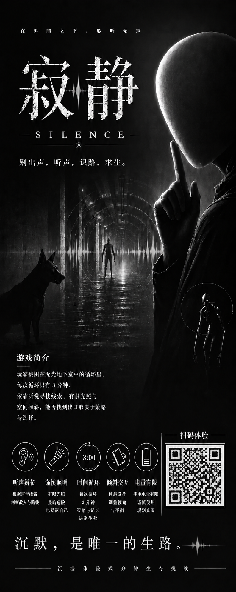
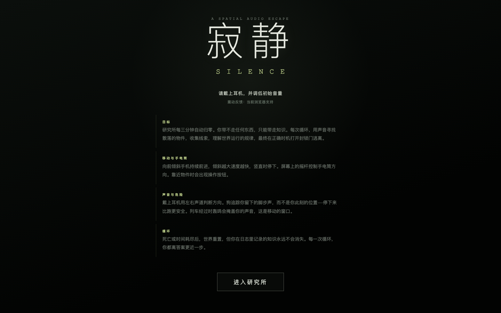

  <h1>寂静 / SILENCE</h1>
  
<strong>A spatial-audio escape through silence, memory and repeating time loops.</strong>

  
  

[最新演示](#最新演示) · [核心体验](#核心体验) · [操作方式](#操作方式)

一款面向手机浏览器的空间音频解谜逃生游戏。研究所每三分钟重置一次：物品会消失，但玩家记录下来的知识会跨循环保留。戴上耳机，通过双耳声场、有限照明和环境线索寻找正确的逃生时机。

## 最新演示

  
  
<strong>沉默，是唯一的生路。</strong> 别出声，听声，识路，求生。

  
<a href="docs/media/silence-poster.png">查看完整海报</a>

## 游戏画面

## 核心体验

- **空间音频探索**：通过左右声道判断声音来源与危险方向。
- **三分钟时间循环**：世界会重置，线索和认知会持续积累。
- **声音驱动的潜行**：怪物追踪脚步声，列车轰鸣则会提供移动窗口。
- **移动端沉浸交互**：支持陀螺仪移动、触控手电筒和震动反馈。
- **程序化视觉表现**：Canvas 2D、动态光照、声波涟漪与像素精灵共同构成黑暗研究所。
- **多端降级支持**：桌面端提供键鼠操作；音频、动作传感器或震动不可用时仍可继续体验。

## 操作方式

### 手机

- 前倾手机：向前移动，倾斜幅度控制速度
- 屏幕摇杆：控制手电筒与观察方向
- 场景按钮：调查物件、记录线索和使用设备

动作传感器通常要求通过 HTTPS 访问。建议佩戴耳机，并从较低音量开始。

### 电脑

- `WASD`：移动
- 按住画面左右拖动：转身
- `Q`：回声探测
- `F`：敲击手电筒

## 团队

团队合作原型；保留原项目成员贡献与署名。原团队维护者：[xiahang467-art](https://github.com/xiahang467-art)。

## 展示范围

本仓库仅包含作品介绍、精选截图、宣传海报与演示视频。项目源码、开发文档和服务端配置不公开。
